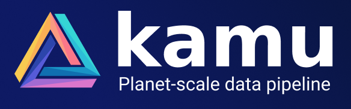
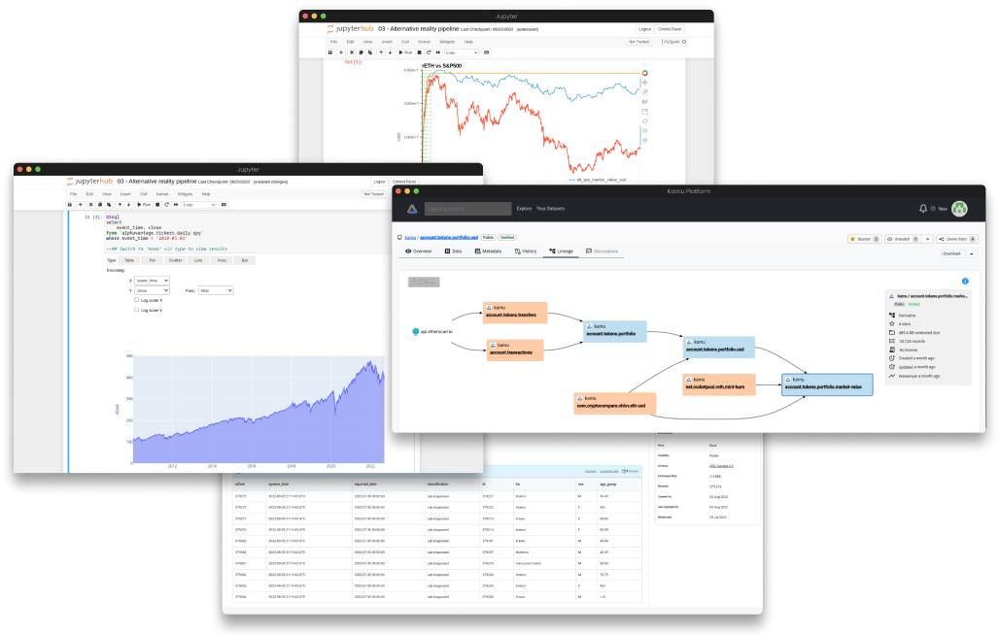

<div align="center">



[](https://github.com/kamu-data/kamu-web-ui/releases/latest)
[](https://github.com/kamu-data/kamu-web-ui/actions)
[](https://discord.gg/nU6TXRQNXC)

</div>

**Kamu Web Platform** is a **front-end application** that acts as a window into the decentralized [Open Data Fabric](https://docs.kamu.dev/odf/) (ODF) network.

<div align="center">

</div>

## For Developers


### Technologies

- [TypeScript](https://www.typescriptlang.org/)
- [Node.js](https://nodejs.org/en/download/releases/), the version [`.nvmrc`](.nvmrc) pins
- [Angular CLI](https://github.com/angular/angular-cli)

Versions are the ones [`package.json`](package.json) declares.

### Libraries

- [Angular Material Design](https://material.angular.dev/)
- [Apollo Angular (GQL client)](https://apollo-angular.com/docs/)
- [GraphQL](https://www.npmjs.com/package/graphql)
- [Bootstrap](https://www.npmjs.com/package/bootstrap)
- [Popper.js](https://www.npmjs.com/package/@popperjs/core)
- [Bootstrap Icons](https://www.npmjs.com/package/bootstrap-icons)
- [Angular powered Bootstrap widgets](https://www.npmjs.com/package/@ng-bootstrap/ng-bootstrap)
- [Prettier](https://www.npmjs.com/package/prettier)
- [ngx-markdown](https://www.npmjs.com/package/ngx-markdown)
- [Vitest](https://vitest.dev/) in browser mode, with [Playwright](https://playwright.dev/) running Chromium

### Steps for running

1. Do it once:

   - download and install [Node.js](https://nodejs.org/en/download/releases/), the version in [`.nvmrc`](./.nvmrc)

   or

   - install Node.js with [Node.js Version Manager](https://github.com/nvm-sh/nvm).

     Using `nvm` (Node.js Version Manager) makes it easier to install and manage multiple versions of Node.js on a single local environment.

     To install the version from `.nvmrc`, run `nvm install` in the repository root

2. Install packages that project depends on: `npm ci`
3. Run application locally: `ng serve` or `npm run start`

### Running with local GQL server

The web UI will by default attempt to connect to the GraphQL server running on `http://localhost:8080`.

If you have the `kamu` tool installed you can use it to serve GraphQL API directly from your workspace using:

```sh
kamu system api-server --http-port 8080
```

Alternatively you can run latest version of the tool with some sample data from a `docker` image:

```sh
# Get the latest image version
docker pull ghcr.io/kamu-data/kamu-base:latest-with-data

# Run with example data
docker run -it --rm -p 8080:8080  ghcr.io/kamu-data/kamu-base:latest-with-data kamu system api-server --http-port 8080 --address 0.0.0.0
```

### Authentication

Authentication requires a JWT secret variable:
- `KAMU_JWT_SECRET` - random base64 string that is used to sign and verify JWT tokens

To authenticate user via GitHub you will also need to pass the following environment variables when running the API server:

- `KAMU_AUTH_GITHUB_CLIENT_ID` - Client ID of your GitHub OAuth app
- `KAMU_AUTH_GITHUB_CLIENT_SECRET` - Client secret of your GitHub OAuth app

### GraphQL schema and code generation

We are using [graphql-codegen](https://www.graphql-code-generator.com/) project to generate typed interfaces based on server's GraphQL Schema and the query templates.

The schema file is located in `resources/schema.graphql`, a copy of `resources/schema.gql` in kamu-cli. To refresh it from kamu-cli's `master` branch on GitHub, use:

```bash
npm run gql-update-schema
```

To regenerate types and query stubs use:

```bash
npm run gql-codegen
```

### Development server

Run `ng serve` for a dev server. Navigate to `http://localhost:4200/`. The app will automatically reload if you change any of the source files.

### Code formatter

Run `npm run prettier` to enforce a consistent style by parsing your code and re-printing it with its own rules that take the maximum line length into account, wrapping code when necessary.

### Code scaffolding

Run `ng generate component component-name` to generate a new component. You can also use `ng generate directive|pipe|service|class|guard|interface|enum`.

### Build:

Run `ng build` to build the project. The build artifacts will be stored in the `dist/` directory.

### Running unit tests

Run `npm test` to execute the unit tests once with [Vitest](https://vitest.dev/) in headless Chromium, with a coverage report in `coverage/kamu-platform`; `ng test` runs them in watch mode. Narrow a run with `npm test -- --include <spec file or folder>`.

The first run needs the Playwright browser: `npx playwright install chromium`.

### Further help

To get more help on the Angular CLI use `ng help` or go check out the [Angular CLI Overview and Command Reference](https://angular.dev/cli) page.

### Release procedure

1. While on the feature branch, add the `CHANGELOG.md` entries under `## [Unreleased]`; the release script turns that heading into the version and date
2. Create PR, wait for tests, then merge
3. Checkout and pull master
4. Run `npm run release-{major,minor,patch}` - this will increment the version in all places, update LICENSE.txt and CHANGELOG.md, commit the changes and create a new git tag
5. Push the version change and the tag: `git push --follow-tags` (a plain `git push` leaves the tag behind, and the release workflow runs only on tags)
6. GitHub Actions will pick up the new tag and create a new GitHub release from it

## Agent Harness

Coding agents (Claude Code, Codex) follow [`AGENTS.md`](./AGENTS.md), with task-specific skills in
`.claude/skills/` and hooks in `scripts/agents/` that enforce the main rules. To use them you need
Python 3, nvm with the Node version from `.nvmrc`, and `npm ci` done once. For Codex, trust the
project and review its hooks with `/hooks`.

After changing anything agent-related (`AGENTS.md`, `CLAUDE.md`, skills, hooks), run
`npm run lint-harness`; CI runs it too. How the harness is built and how to change it:
[`docs/internal/agent-harness.md`](./docs/internal/agent-harness.md).
