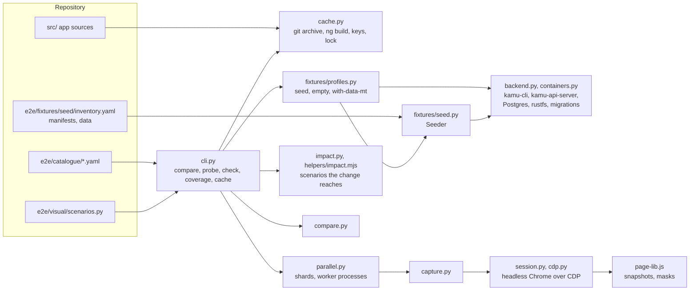
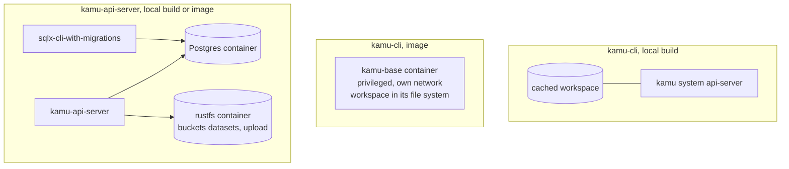

# Visual Comparison

How the kit under `e2e/` compares two builds of the UI: what it guarantees, how a run flows, how
backends and data are set up, what a snapshot contains, what keeps it deterministic, and what was
tried and dropped. How to run it is in [`e2e/README.md`](../../e2e/README.md); when to run it and
how to act on a report is the [`kamu-ui-visual-checks`](../../.claude/skills/kamu-ui-visual-checks/SKILL.md)
skill.

## Purpose and guarantees

A style refactoring or a library upgrade can pass lint and unit tests and still change a page.
The kit renders the same business scenarios on two builds against the same data and reports the
difference.

- **Both sides see the same data.** Base and head are captured against one running backend per
  profile, split into the same shards.
- **Styles are the signal, pixels confirm.** For the watched elements every computed property is
  compared exactly; a pixel difference without a style difference is captured again before it is
  reported.
- **Nothing is committed but sources.** Builds, data and baselines are caches outside the
  repository, keyed by everything they depend on, and can be rebuilt at any time.
- **Scenarios carry business meaning.** Each realises an entry of the catalogue, which a person
  rates; unrated and dropped entries do not run by default.

## Components



Three Node helpers under `e2e/visual/helpers/` print JSON for the Python side: the app's route
table (read from the routing files with the TypeScript compiler), the class selectors of
`src/assets/styles/var.scss` (compiled with the repository's `sass`), and the components a set of
changed files reaches (from the app's imports).

## A compare run

```mermaid
sequenceDiagram
    participant C as cli.py
    participant K as cache.py
    participant P as profile
    participant B as backend
    participant G as Chrome
    C->>C: load and check catalogue, scenarios, inventory
    C->>K: take capture.lock (one compare at a time; it runs its own workers)
    C->>K: base: git archive, npm ci or symlinked node_modules, production build (cached by commit)
    C->>K: head: production build of the working tree or --head
    C->>C: select: changed files → components (impact.mjs) → scenarios that showed them
    par each profile with selected scenarios, at once
        C->>P: open(backend)
        P->>B: start, fill (seed) or reuse a cached workspace
        C->>B: schema check: every .graphql document of both trees
        alt baseline cached
            C->>C: reuse it, capture head in shards
        else
            C->>G: capture base and head in shards, at once
        end
        C->>C: compare; recapture pixel-only scenarios on head alone
        C->>B: stop, discard containers
    end
    C->>C: report.md
```

Scenarios of one shard run in order in one browser tab with in-app navigation, as a user would
move through the app: a component's styles that leak onto later pages of the shard show up there.
Logged-out scenarios come last in each shard.

### Shards and workers

`parallel.py` captures a side in shards: the scenarios, with each `follows` chain kept together,
dealt round-robin in list order into `--jobs` shards (default: a quarter of the cores, at most 8).
The split depends only on the scenario names and the shard count, and the shard count is part of
the baseline key, so base and head always run the same shards. Every shard of every side and
profile goes to one pool of `--jobs` worker processes, each with its own Chrome on its own CDP
port; the profiles' backends and UI servers are started first and shared by their shards. A worker
reports each finished scenario through a queue, for the progress lines, and the shards' folders
are merged into the usual capture layout.

Worker processes, not coroutines in one interpreter: in one process, the snapshots' JSON and gzip
work blocks the event loop, and with eight captures the browsers' websocket keepalives went
unanswered and four of the eight connections dropped.

### Selecting by the change

Without `--all` or `--only`, a run covers the scenarios the change can alter. Nothing about the
selection is kept by hand, so it follows the app as it changes:

| Step | Source |
|---|---|
| Changed files | `git diff` between base and head, with untracked files for the working tree |
| Files to components | `helpers/impact.mjs`: a component's own `.ts`, template or stylesheet reaches that component; any other file reaches the components importing it, through files that are not components, read from the imports on every run |
| Components to scenarios | `components.json`: the custom elements each scenario showed at its latest successful capture of either side, rewritten by every capture |

| Selects every scenario | Why |
|---|---|
| `src/` outside `src/app` (global styles, `index.html`, `main.ts`), `package.json`, `angular.json`, `tsconfig*.json` | they apply to every page |
| a stylesheet with `::ng-deep`, a component with `ViewEncapsulation.None` | its styles reach other components |
| a deleted file, a file under `src/app` that no component owns (a `.graphql` document) | its users cannot be read any more, or not statically |
| `e2e/visual/`, `e2e/fixtures/` | the capture itself changed |

A scenario never captured runs. A scenario that `follows` another runs whenever that one does: it
is the page where the other's leaking styles would show. A changed component that no record
contains selects nothing and is named in the report: a component new to a page arrives through its
parent's template, whose change selects that page.

## Backends

A backend is a kind (kamu-cli or kamu-api-server) and a build (PATH, `--bin`, `--release`,
`--image`). `BackendChoice` resolves the build only when a profile asks for it; `with-data-mt`
needs the kind alone.



- **kamu-cli, local build:** the only backend that keeps a workspace between runs, under
  `workspaces/<profile>-<data id>-<build id>`.
- **Images** run as published. The profile's content is created inside the container, in its
  own file system, and discarded with it. They run privileged so kamu's podman can start engine
  containers, as the deployments run them.
- **kamu-api-server** gets a config generated from the fixtures' node settings: Postgres with a
  raw password, `repo.repoUrl` and `uploadRepo` on S3, the accounts as a password provider and a
  GitHub provider with dummy settings. The database is migrated first by the
  `sqlx-cli-with-migrations` image of its kamu core version, which is read from kamu-node's
  `Cargo.lock` at the release tag, as the Helm chart's init container does.
- **Networks:** the containers of one server share a network of their own and reach each other
  by name; only the ports the browser or a local build needs are published, on 127.0.0.1.
  Engines run in the server container's network (`engine.networkNs: Host`), as the published
  images configure their podman and the Helm chart configures kamu.

Ports: API 8090 (`seed`), 8091 (`empty`), 8092 (`with-data-mt`); Postgres and S3 of an API server
on its port plus 1000 and 1100; the served UI on 4310 (base) and 4311 (head); Chrome's debugging
port 9233. Port 8080 is left to a developer's own server.

## Data profiles and the inventory

| Profile | Content | Clock |
|---|---|---|
| `seed` | created through the API from `inventory.yaml` | seeding time plus two hours |
| `empty` | accounts only | the same |
| `with-data-mt` | the published with-data image of the backend kind, pinned by digest | image creation time plus two hours |

`inventory.yaml` is both the seed plan and the maintainer's inventory: every account, dataset,
flow run, variable, collaborator, webhook, collection entry and file version, with its purpose,
state and the catalogue entries that rely on it. `seed.py` creates exactly what it lists, in
order; webhooks last, so no delivery is ever attempted. A polling source reads files the seed
places in the server's `seed-data/`; one file arrives between flow runs, so a later ingest finds
something new.

The with-data images are adapted, not rebuilt: their config gets a signing key (for `/query`),
one DataFusion partition, dummy GitHub settings, and for kamu-api-server the secrets encryption
key under its current name.

## What a snapshot holds

`capture.py` runs each scenario, then `page-lib.js` in the page:

1. **Masks volatile values** in text and form fields (see below), so they neither show in the
   screenshot nor shift the layout.
2. **Screenshot** of the full page, up to 5000 px high.
3. **Computed styles** of every element under the roots: Material, ngb, ng-select, multiselect,
   table, stepper, modal and pagination roots, plus every element a utility class of the
   **base** tree's `var.scss` matches. Each element is keyed by a class-free path (tag and
   position), so a changed class shows as a changed field rather than a different element. Its
   style is stored as a delta against a bare element of the same tag, and `::before`/`::after`
   against the element. A custom property (a Material token, a Monaco variable) is recorded only
   where it is set, where its value differs from the parent's: a changed token shows once, at its
   source, and in the resolved properties it changes everywhere else.
4. **Forced states**: for the `FORCE_TARGETS` in `scenarios.py`, `:hover`, `:focus` (with
   `:focus-visible`) and `:active` (with `:focus`, as a mouse press focuses the button) are forced
   through CDP, and the target's parent subtree (the target, its descendants and its siblings) is
   snapshotted again after the transition.

`compare.py` rebuilds full styles from the deltas and compares them exactly; screenshots are
compared per pixel, ignoring channel differences up to 16. Verdicts: `same`, `changed` (styles
differ), `pixels-only` (rechecked: `noise` if a head capture alone matches the base, else
`confirmed`), `missing`.

## Determinism

| Source of variation | What keeps it out |
|---|---|
| The current time | the page's `Date` starts at the profile's frozen clock and restarts at every scenario; the query timer's 10 ms interval is dropped |
| Ids, hashes, DIDs, secrets, absolute times, measured durations | masked in the page to fixed values of the same format; times relative to the clock stay |
| Row order of an unordered query | the data tab scenarios pass an ordered query in the URL; queries run on one DataFusion partition |
| External hosts (avatars) | Chrome resolves only localhost and Google Fonts |
| Captures at once | each worker has its own Chrome, profile folder and CDP port; Chrome runs without GPU, font hinting and LCD text, and eight concurrent captures matched a sequential one; `capture.lock` keeps a second `compare` out |
| Hover and focus left over | the mouse is parked and focus blurred before each capture; overlays left open fail the next scenario |
| Animations and transitions | a settle delay after each scenario; after a hover or a forced state and around the screenshot, a wait until no transition or finite animation runs, so a loaded machine does not catch a fade halfway |
| A hover moved by a reflow | the screenshot captures beyond the viewport, which resizes it, only for pages taller than the viewport |
| A changing backend | nothing is scheduled; the seed waits until no flow is waiting, running or retrying |

## Caches and keys

| Cache | Key |
|---|---|
| `src/<sha>`, `builds/<sha>` | the commit |
| `workspaces/` | profile, data id (hash of the fixtures and the seed code), build id |
| `baselines/<base sha>-<profile>-<hash>` | data id, backend id, kit hash (the capture code under `e2e/visual`: its Python files, `page-lib.js` and the helpers, without the comparer; taken once per run), Chrome major version, production build, scenario names, utility roots, shard count |
| `backends/<kind>-<version>` | release version, unpacked atomically |
| `backend-ids.json` | a binary's path, mtime and size → its version and content hash |
| `components.json` | `<side>:<profile>/<scenario>` → the custom elements its latest successful capture showed, for the selection; not part of any key |
| `timings.json` | `<profile>/<scenario>` → seconds its last capture took, for the progress estimates; not part of any key |

A baseline with a failed scenario is not stored. Because volatile values are masked, a baseline
stays valid when the backend is filled afresh, as every non-workspace backend is on every run.

### Retention

`retention.py` decides what stays. An entry (a run, a baseline, a commit's sources and build
together, a workspace, a release) is marked used (`.used`) whenever a run reuses it, and a Docker
image is recorded in `images.json` when the kit pulls it, so images the kit did not pull are never
touched. The prune at the end of every `compare` and `cache prune` apply, in order:

| Rule | Default |
|---|---|
| Keep whatever was used since the running compare started | always |
| Remove unfinished entries (`*.partial`) | always |
| Keep the newest runs | 10 |
| Remove entries and the kit's images unused for longer, except pinned images | 14 days |
| While the total is over the ceiling, remove the least recently used, runs first | `KAMU_VISUAL_CACHE_MAX`, 10G |

What is never reused is not kept at all: the working tree's build lives in the run folder until the
run ends, and a base commit's `node_modules` is installed only to build it, then deleted.

## Consistency checks

`npm run e2e-check` (CI) runs the unit tests and `visual -- check`, which needs neither a browser
nor a backend:

- catalogue entries: required fields, unique ids, known personas, profiles and tiers, routes that
  exist in the app's route table;
- scenarios: unique names, an existing catalogue entry each;
- inventory: catalogue entry ids exist; every file under `fixtures/seed/` is listed and exists;
  manifests are named after their dataset; references between artifacts resolve; every dataset a
  `seed` scenario opens or looks up is listed (computed URLs are evaluated against a stand-in
  session that records the lookups).

## Extension points

| To add | Where |
|---|---|
| A scenario | `SCENARIOS` in `scenarios.py`, next free number, with its catalogue entry; see the skill |
| A fixture | `inventory.yaml` (and a manifest or data file); the seeder creates it |
| A volatile format | `VOLATILE` in `page-lib.js`, with a fixed replacement of the same format |
| A snapshot root | `ROOTS` in `page-lib.js`; utility classes come from `var.scss` on their own |
| A forced state target | `FORCE_TARGETS` in `scenarios.py` |
| A profile | `PROFILES` in `fixtures/profiles.py`: `data_id`, `backend_id`, `open` |
| A backend kind | `FLAVORS` in `backend.py`, and a start path in `WorkspaceProfile.open` |

## Failure modes

| Symptom | Cause |
|---|---|
| The run stops before capturing, listing GraphQL errors | the backend's schema lags the app; choose a newer build |
| Pages hang on "Loading…" in a `probe` | the same: `probe` does not run the schema check |
| `port … is already in use` | another run, or a container left by an interrupted one; `docker ps` |
| A transform flow fails with an engine timeout | the engine could not start or be reached inside a container: check `engine.networkNs` and the server log under `runs/<time>/backend-<profile>/` |
| `pixels-only, confirmed` in a scenario that shows ids or times | a volatile format the masks do not know yet |
| A profile's section in `report.md` says it failed, and the run exits with an error | its backend did not start, the schema check failed, or a capture broke; the other profiles are still compared, and the traceback is in `run.log` |

## Rejected approaches

| Approach | Why not |
|---|---|
| Committed baseline screenshots | Binary churn in every style change, and stale the moment the data or Chrome changes; baselines are caches keyed by what they depend on |
| Pixels as the signal | Data and timing differences (row order, measured durations) change pixels without any style change; computed styles name the element and property that changed |
| Comparing ids, hashes and absolute times | They differ between two fillings of the same data, so a cached baseline would break on every reseed; they are masked |
| Running kamu containers on the host network | The machine restarted twice while kamu's podman inside a privileged container on the host network ran engine containers; each server now has a network of its own |
| SQLite or local storage for kamu-api-server | Deployments run Postgres and S3; the kit runs the same |
| Derived images with the data baked in | Images run as published, so what is tested is what is deployed; the data goes into the container's own file system |
| Numbered fixtures (`extra-01`…) | Unreadable for a maintainer; the inventory names every artifact and says why it exists |
| Captures one at a time | A full run took 80 minutes; with `--disable-gpu`, `--font-render-hinting=none` and `--disable-lcd-text`, eight concurrent Chromes rendered the same pixels and styles as one alone (one pixel of a data tab differed, which the recheck classes) |
| Shards as coroutines in one Python process | The snapshot's JSON and gzip work blocks the shared event loop; four of eight browser connections dropped on unanswered keepalives, and eight captures took 2.7 times one, not one time |
| The kit in JavaScript | Harder to read next to the Python agent harness; JavaScript stays where it must run: in the page, and where the TypeScript compiler and `sass` are needed |
